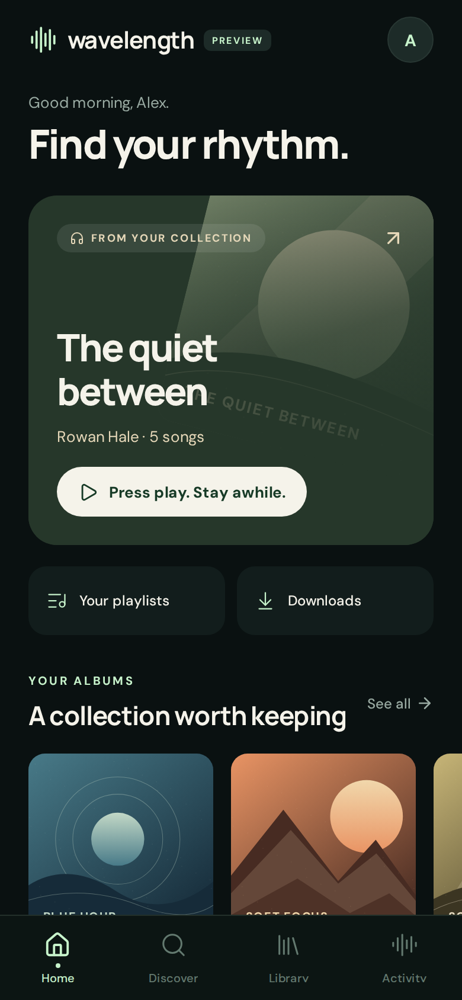
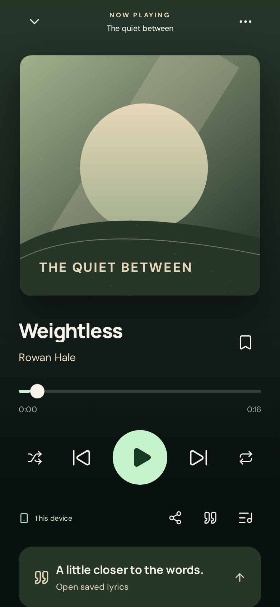
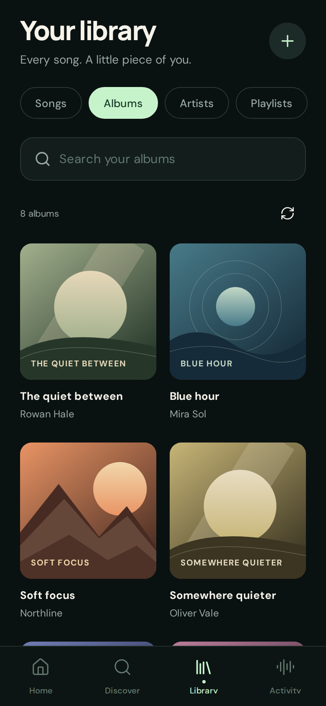

# Wavelength for iOS and Android

A standalone React Native app for the existing Wavelength service. Ink surfaces, warm ivory typography, celadon controls, generous artwork, and motion that gets out of the music’s way. There are no recommendation feeds or invented backend capabilities.

<p>
  
  
  
</p>

## Installed web app

Open `https://wavelength.prayujt.com/app/` and use your browser’s Install or Add to Home Screen action. Open the installed icon and sign in. The Svelte website remains at `/`.

Only the installed Expo web app exposes **Download to device** controls. Save a song from its menu, or save an album/playlist with the collection download button. **On this device** shows complete downloads, storage usage, removal controls, and pending history. Ordinary browser tabs and the Svelte website do not download local music. The existing Downloads/Activity screen acquires music onto the **server**, which is a separate operation.

The app shell, fonts, full audio files, metadata, artwork when available, lyrics, device queue/position, and playback preferences survive closing the installed app. Saved music can cold-start, play, skip and seek offline, including when online credentials have expired. Discovery, server imports and server mutations require connectivity. Interrupted, partial and quota-failed downloads are never marked available offline. Keep the app open until downloads finish. Browser storage can be reclaimed or cleared; persistence requests are best effort.

Browser delegated Wavelength credentials use a dedicated IndexedDB vault, protected by the same-origin CSP. Provider credentials are never sent to the client or service-worker cache. Web Locks serialize refresh across windows (with an IndexedDB lease for older browsers). Token lifetimes are unchanged. A failed refresh caused by a network outage preserves credentials; actual rejection requires reconnecting for server operations while retaining local access. Explicit sign-out stops playback and clears the active account’s local credentials, downloads, queue and pending history, even offline. Revocation is best effort when the server cannot be reached. Account partitions use server origin plus the backend’s stable user ID.

Listening checkpoints are durable and replay in session order after authenticated identity validation. Original event times are preserved; session starts atomically increment aggregate plays once, so uncertain delivery/retry cannot duplicate counts. Permanently unavailable/deleted-track events are retained as failed records, shown in storage status. The installed app keeps its queue on the device, initially importing the server queue if needed; reconnect never automatically overwrites another device’s server queue.

Updates download a new disposable app shell in the background and wait while existing windows remain open. Close all Wavelength windows after listening, then reopen to activate an update. No reinstall or music redownload is required; account/music/outbox storage is separate from versioned code caches. Browser lock-screen controls use Media Session. Physical iOS/Android testing is still needed to establish OS-specific background playback and download interruption behavior. Native Expo builds remain supported; the offline browser storage described here belongs to the installed PWA.

```sh
npm run build:pwa  # production /app/ export and complete service-worker precache
```

The container builds this export into `/web/app`. `/app/` routes have their own SPA fallback, CSP, immutable hashed assets and revalidated worker/manifest. Native OAuth callbacks and `/mobile-auth.html` keep their existing paths.

## Run in Expo Go

Use Node **24.15** (or a compatible Node 24 release at least 24.3), and the **SDK 57** version of Expo Go. SDK 58 was newer when this app was created, but SDK 57 is the version supported by the current app-store Expo Go during that transition. See [Expo’s project setup instructions](https://docs.expo.dev/get-started/create-a-project/).

```sh
cd mobile
npm ci
npm start
```

Scan the QR code in Expo Go on a phone reachable from the development machine. For a remote development host or different networks, `npm run start:tunnel` starts Expo’s development tunnel; its SDK-compatible tunnel helper is included in this package. Stop the development server when finished. This does not deploy or expose the Wavelength backend.

The app defaults to `https://wavelength.prayujt.com`. Change the server in the welcome screen’s connection options, or set `EXPO_PUBLIC_WAVELENGTH_URL` before starting Metro. This is a **public address**, never an API key, client secret, or user token.

“Take a look around first” opens a clearly labeled preview with fictional artists, original procedural artwork, and an original short ambient audio clip. Its library, downloads, playlists, history, and shares are isolated in memory; it makes no requests to the real music service and disappears when the app restarts. It is useful for reviewing the interface without an account.

### Sign-in and returning to Expo Go

The app uses Wavelength’s existing OAuth endpoints, a dynamically registered **public client**, S256 PKCE, a per-device state value, and the existing Authentik sign-in. It requests read, write, stream, and ingest permissions. No Authentik application or client secret is bundled in the app.

Native tokens and pending PKCE state live in Expo SecureStore. The browser review build uses tab-scoped session storage. Refreshes are serialized; sign-out clears credentials and the query cache. Media and artwork credentials stay on the selected server’s origin.

Expo Go does not support app-specific OAuth callback schemes, as [Expo documents](https://docs.expo.dev/guides/authentication/). The small `web/public/mobile-auth.html` return page bridges the existing HTTPS callback to the app’s Expo Go `exp://…/--/oauth/callback` link. It offers a deliberate **Return to Wavelength** action and a copy/paste fallback when the OS does not hand the link back. Standalone builds use `wavelength://oauth/callback` through the same page. The return page checks the issuer and allowed target scheme, removes the one-time code from browser history, uses no third-party resources, and is served with `no-store` and `no-referrer`.

**The return page must be included in the deployed web image before signing in from the native app.** This PR ships it with the existing web build; it does not add an API, token relay server, or separate Authentik application. Browser fallback: after approval, tap **Copy return link instead** on the return page, return to the app, open connection options, and choose **Finish connecting**.

## What works

| Area             | Existing API                                                                                                                                 |
| ---------------- | -------------------------------------------------------------------------------------------------------------------------------------------- |
| Home and library | Songs, albums, artists, paginated browsing, collection search, album/artist navigation                                                       |
| Discover         | Catalog search, artist discographies, release inspection, exact provenance matches and partial-album counts                                  |
| Downloads        | Album/song imports, durable job status, cancellation, retries, manual source previews and selection, explicit audio replacement              |
| Playlists        | Create, rename, describe, visibility, add/remove songs, reorder, play, shuffle, delete                                                       |
| Player           | Range-capable audio, persistent mini-player, seeking, previous/next, queue editing, shuffle/repeat, saved queue restoration without autoplay |
| Lyrics           | Saved plain/timed lyrics, current-line following, tap-to-seek                                                                                |
| Bookmarks        | Save a position, resume it, delete it                                                                                                        |
| Sharing          | Explicit public listening links, copy/native share sheet, expiry information, revocation                                                     |
| Listening        | Actual listening time and position, completed/skipped/stopped outcomes, paginated and filtered personal history                              |

Library updates use the existing realtime subscription, reconnect on app foreground, and fall back to polling on restricted networks. Screens retain their rows while new tracks arrive.

All service calls use generated Connect clients and the existing protobuf schemas. Unary requests use Expo’s fetch implementation and bearer authentication, with cookies omitted. Acquisition keeps automatic source choice on the backend; the app only passes an explicit source when the listener chooses one. Audio streams use short-lived, single-track playback links kept in memory and revoked when replaced or cleared.

The player engine lives outside React screen lifetimes. A stale source request cannot restart a song after a newer selection or sign-out. Queue order and positions persist through `UserDataService`; a restored queue waits for an explicit play action. Listening reports exclude pauses, buffering, and seek jumps. An abrupt OS termination can lose the final reporting interval.

Expo Go can exercise the UI, OAuth handoff/fallback, and foreground audio with its included native modules. Background audio configuration and lock-screen behavior are configured for standalone builds, but Expo Go cannot apply custom native configuration. Validate sustained background playback, interruption handling, Bluetooth controls, and native accessibility on physical iOS and Android devices before a store release. No native device or store-signing result is implied by a Metro export.

## Independent builds

This directory has its own dependencies, lockfile, generated client, tests, and CI. It imports nothing from `web/`. The server image builds both the Svelte website and this project’s `/app/` export; mobile changes trigger a new image. Native validation remains a separate CI job, and protocol changes check both generated clients. The existing OAuth return page remains shared with native clients.

```sh
npm run generate       # regenerate from ../proto, without web/node_modules
npm run check
npm run lint
npm run format:check
npm test               # auth, queue, playback races, lyrics, listening, preview wire contracts
npx expo install --check
npx expo-doctor
npm run export         # iOS + Android bundles and the browser review build
npm run build:pwa      # /app/ production export and offline shell
npm run test:ui        # phone-size browser flows, responsive checks and callback security
```

The browser review server binds only to `127.0.0.1`. Playwright uses isolated preview/OAuth fixtures and never reads real account credentials. Native exports validate the platform bundles; browser tests exercise the shared React Native UI, not a simulator.

`eas.json` supplies preview APK, development, and production build profiles. Set up your own Expo project and signing credentials with `npx eas-cli@latest init` before requesting builds. The development profile includes Expo Dev Client; `npm start` explicitly selects Expo Go, so no custom development build is required for review. Nothing in the app or CI publishes an update, starts a cloud build, or changes the running Kubernetes service.

## Structure

- `src/app/`: Expo Router routes and navigation.
- `src/screens/` and `src/components/`: screens, design primitives, artwork, player dock, and action sheets.
- `src/core/`: platform-independent OAuth, playback/queue orchestration, lyrics, and listening accounting.
- `src/lib/`: Expo adapters, authenticated clients, account/query lifetimes, and native audio integration.
- `src/gen/`: reproducible protobuf clients owned by this package.
- `src/preview/`: opt-in in-memory collection using the same generated wire contract.
- `tests/`: protocol/auth/player unit checks and browser interaction/security tests.

Fonts are bundled from the SIL Open Font License DM Sans and Manrope packages. Icons use Lucide (ISC). Preview covers are drawn locally in `src/components/artwork.tsx`; icons and audio are regenerated by `node scripts/assets.mjs`; they contain no private library data or third-party recordings.
